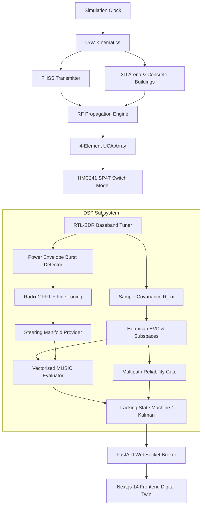

# System Architecture Specification
## EC261: Frequency-Hopping-Aware Direction Finding for UAV Telemetry

### 1. Architectural Philosophy
The simulation suite strictly separates **Physical Ground Truth** from **Receiver Measurements** and **DSP Estimators**:
1. **Authoritative Python Physics & DSP Core:**
   - All spatial coordinates, RF propagation equations, antenna manifold physics, AWGN noise generation, and subspace linear algebra are executed inside the Python engine using NumPy and SciPy.
   - The frontend never fabricates bearing results, estimates angles, or cheats by reading ground truth state.
2. **Deterministic Time Reference:**
   - A master simulation clock coordinates UAV flight kinematics, transmitter hopping, ray tracing, and receiver sampling.
   - Every frame uses a synchronized simulation time $t$, discrete step $dt$, and reproducible PRNG seed.
3. **Decoupled Data Flow & Serialization:**
   - High-rate telemetry frames are broadcast via WebSocket at $\sim 20$ Hz.
   - High-density spectral diagnostics (raw IQ waveforms, FFT spectrum, MUSIC pseudospectrum) are streamed at $\sim 4$ Hz or on demand to avoid client network saturation.

---

### 2. Subsystem Interfaces

#### A. `backend/simulation/`
- **`clock.py`**: Controls global time advancement, stepping, pause/resume, playback speed multiplier ($0.1\times$ to $10.0\times$), and timestamped event logging.
- **`trajectories.py`**: Parameterized analytical trajectories:
  - *Figure-Eight (Gerono Lemniscate):* $x(t) = a \sin(\omega t)$, $z(t) = b \sin(\omega t) \cos(\omega t)$.
  - *S-Curve Slalom:* $x(t) = x_{span} \cos(\omega t)$, $z(t) = z_{span} \sin(2\omega t) - 10$.
  - *Circular Orbit:* $x(t) = R \cos(\omega t)$, $z(t) = R \sin(\omega t)$.
  - *Waypoint Path:* Closed-loop perimeter patrol waypoints guaranteeing clearance around structural boundaries.
- **`collision.py`**: Analytical 3D AABB swept-segment slab test `swept_segment_in_collision(p0, p1, extra_buffer)` with physical UAV radius ($0.8$ m) and safety margin ($2.2$ m), guaranteeing a $3.0$ m envelope around Building Alpha and Building Beta.
- **`obstacle_avoidance.py`**: Predictive lookahead ($2.5$ s), analytical visibility graph for shortest collision-free bypass routes, critically damped second-order dynamic tracking ($k_p = 4.0, k_d = 4.0, a_{\max} = 8.0\text{ m/s}^2, v_{\max} = 12.0\text{ m/s}$), and emergency braking with automatic recovery.
- **`uav.py`**: Maintains authoritative 3D position $p(t) = [x, y, z]$, velocity $v(t)$, heading $\psi(t)$, pitch/roll attitude, ground truth azimuth $\theta_{true} = \text{atan2}(z, x)$, elevation $\phi_{elev}$, and flight trail history.
- **`environment.py`**: Manages the 120m × 120m arena, axis-aligned concrete structures, ray occlusion tests, and Image Source Method specular reflection queries.
- **`multiradar.py`**: Multi-Radar localization engine solving $\left(\sum w_i (I - d_i d_i^T)\right) p = \sum w_i (I - d_i d_i^T) r_i$ for multi-station 2D target fix and Geometric Dilution of Precision (GDOP).

#### B. `backend/rf/`
- **`fhss.py`**: Emulates ExpressLRS pseudo-random hopping sequence over $[433, 868, 915, 920, 928]$ MHz.
- **`signal_model.py`**: Synthesizes complex baseband packet bursts with carrier offsets $f_{BB} = f_{RF} - f_{LO}$ and raised-cosine power amplifier ramping.
- **`path_loss.py`**: Calculates Friis free-space path loss and distance-dependent carrier phase accumulation.
- **`multipath.py`**: Synthesizes delayed, attenuated, and dispersive concrete wall reflections.
- **`noise.py`**: Generates zero-mean complex Gaussian noise strictly calibrated to $E[|n|^2] = P_{sig} \cdot 10^{-\text{SNR}_{dB}/10}$.
- **`em_solver.py`**: 2D TMz Yee-grid FDTD simulation with conductive dielectrics, absorbing sponge boundaries, and complex dielectric impedance ($\varepsilon^*, \mu^*, \eta, |\Gamma|$).
- **`em_solver_3d.py`**: 3D Cartesian vector Maxwell Yee-grid FDTD simulation ($E_x, E_y, E_z, H_x, H_y, H_z$) with Courant limit checking ($C \le 0.95$).

#### C. `backend/hardware/`
- **`uca.py`**: 4-element Uniform Circular Array ($r = 0.072$ m, $\phi_m = 0^\circ, 90^\circ, 180^\circ, 270^\circ$).
- **`rf_switch.py`**: Analog Devices HMC241 SP4T non-reflective switch, modeled with GPIO actuation, switching dwell slots, and transient settling samples.
- **`sdr.py`**: RTL-SDR tuner with LO frequency $f_{LO}$, 2.0 MS/s baseband filter, and acquisition evaluation.
- **`sampling.py`**: Implements Mode A (simultaneous 4-channel) vs Mode B (single SDR switched) with temporal phase de-rotation $e^{-j 2\pi f_{BB} \Delta t_m}$.

#### D. `backend/dsp/`
- **`burst_detection.py`**: Sliding-window energy detector $P[n] = I^2[n] + Q^2[n]$.
- **`frequency_estimation.py`**: Radix-2 FFT peak search with differential phase fine-tuning ($< 10$ Hz error).
- **`steering.py`**: Frequency-compensated manifold $a(f_k, \theta)$ and static baseline $a(f_{ref}, \theta)$.
- **`covariance.py`**: Sample covariance $R_{xx} = \frac{1}{N} X X^H$ with Hermitian preservation.
- **`eigendecomposition.py`**: Hermitian EVD, descending eigenvalue sort, and noise projector $P_n = E_n E_n^H$.
- **`eigenvalue_gate.py`**: Spread ratio $\gamma = \lambda_1 / \lambda_2 \ge 8.0$.
- **`music.py`**: Vectorized circular pseudospectrum across $[-180^\circ, +180^\circ]$.
- **`esprit.py`**: Beamspace Phase-Mode UCA-ESPRIT using Bessel mode harmonic transformation $j^m J_m(kr)$ and shift-invariance TLS/LS.
- **`power_vector.py`**: Switched-beam Power-Vector ML estimator with Fisher scoring, reduced deviance Cramér-Rao bounds, and Power-Weighted Centroid.
- **`tracker.py`**: Adaptive Kalman Filter with continuous acceleration process noise $Q(q, \Delta t)$, $\chi^2$ NIS gating, maneuver detection ($4.0\times Q$), and Gated Hold state machine.

#### E. `backend/api/`
- **`main.py`**: FastAPI application exposing REST and WebSocket endpoints.
- **`websocket.py`**: Real-time telemetry broadcast and client command handling.
- **`export_excel.py`**: OpenPyXL telemetry exporter generating styled `.xlsx` workbooks with freeze panes, auto-filters, and auto-adjusted column widths.

